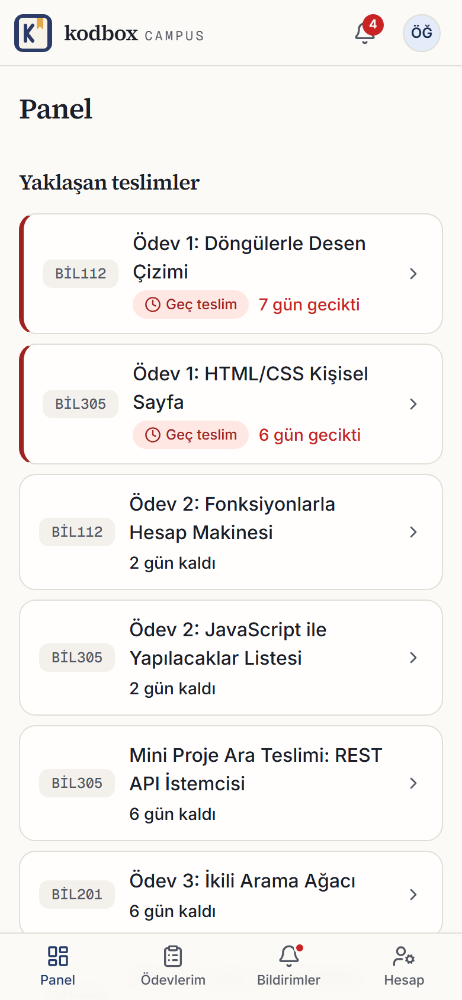
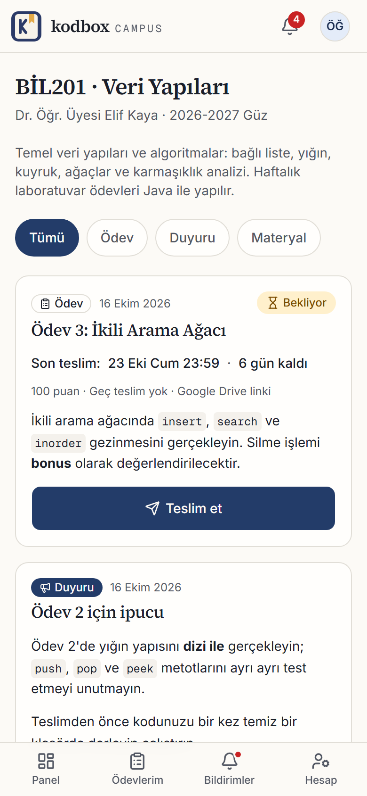
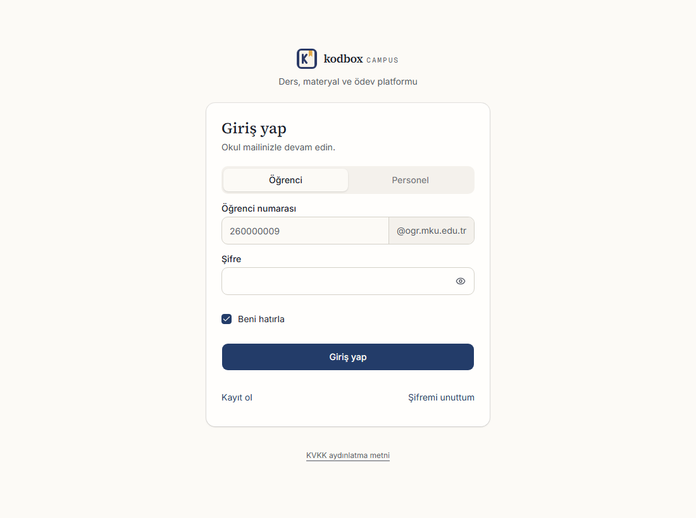
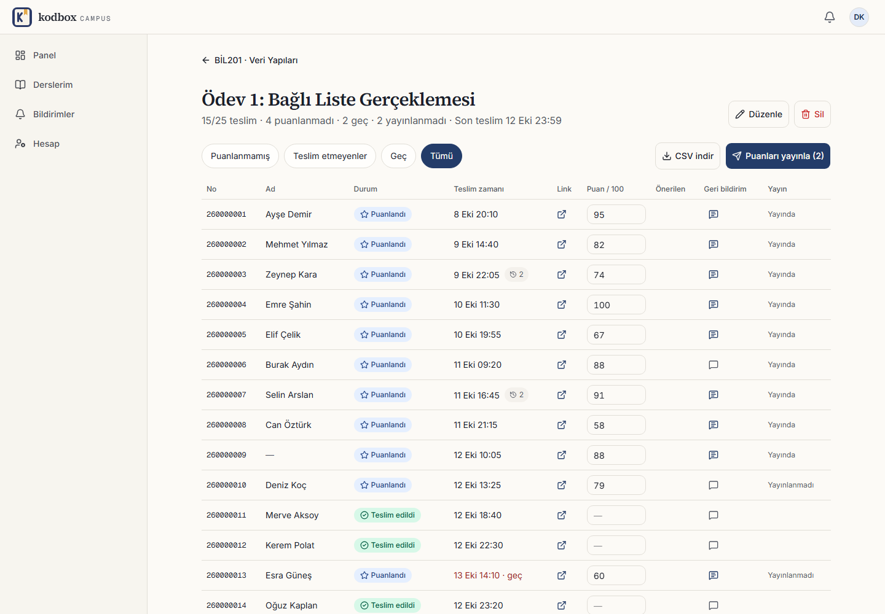

<div align="center">


# Kodbox Campus

**Ders, materyal ve ödev platformu: eğitmen ders açar, öğrenci Drive linkiyle telefondan teslim eder.**

[](https://nextjs.org)
[](https://www.typescriptlang.org)
[](https://www.postgresql.org)
[](https://orm.drizzle.team)
[](https://tailwindcss.com)
[](LICENSE)


</div>

**English:** Born from a real classroom problem: an instructor collected homework as Drive links sent by email. Kodbox Campus is a course, material and assignment platform for universities. Instructors create courses, add students by pasting school numbers, and post announcements, materials and assignments. Students submit work by pasting a Google Drive link, mostly from a phone, in at most three taps; the platform stores no files. Built with Next.js 16, TypeScript, PostgreSQL and Drizzle. Personal data (emails, student numbers, roster names) is encrypted with AES-256-GCM and looked up through HMAC blind indexes. The first deployment targets Mustafa Kemal University, but schools, mail domains and student-number formats are configurable per school. The UI is Turkish only. MIT licensed.

## Neden?

Bu proje okulda yaşadığım bir durumdan çıktı. Bir öğretim görevlimiz ders notlarını Google Drive'a yüklüyor, ödevleri de "dosyayı Drive'a yükle, linkini mailime gönder" diye istiyordu. Öğrenci olarak her dersin notu, duyurusu ve son teslim tarihi farklı bir yerde kalıyordu. Hoca da hangi linkin kime ait olduğunu, kimin teslim edip kimin etmediğini e-posta kutusundan tek tek takip edip not vermek zorundaydı.

Kodbox Campus aynı alışkanlığı (Drive'a yükle, linkini gönder) bozmadan bu dağınıklığı toplar:

- **Öğrenci** tüm derslerinin notlarını, duyurularını ve yaklaşan teslimlerini tek panelde görür. Ödevini telefondan Drive linkini yapıştırarak en fazla üç dokunuşla teslim eder.
- **Eğitmen** teslimleri e-posta yerine tek bir tabloda görür: kim teslim etti, kim etmedi, kim geç kaldı. Puanı tabloya yazıp Enter'la sonraki öğrenciye geçer, puanları tek tuşla yayınlar.
- **Platform dosya saklamaz.** Dosyalar yine öğrencinin Drive'ında kalır; depolama maliyeti ve dosya güvenliği yükü yoktur.
- **Çok okul desteği** yapıdadır. Her okul için öğrenci ve personel mail alan adı ile öğrenci numarası düzenli ifadesi (regex) tanımlanır. İlk okul Mustafa Kemal Üniversitesi'dir (MKÜ).

## Ekran görüntüleri

<table>
  <tr>
    <td align="center" width="50%">
      <br />
      <sub>Öğrenci paneli (telefon)</sub>
    </td>
    <td align="center" width="50%">
      <br />
      <sub>Ders akışı (telefon)</sub>
    </td>
  </tr>
  <tr>
    <td colspan="2" align="center">
      <br />
      <sub>Giriş</sub>
    </td>
  </tr>
  <tr>
    <td colspan="2" align="center">
      <br />
      <sub>Eğitmen teslimler tablosu (masaüstü)</sub>
    </td>
  </tr>
</table>

## Özellikler

### Öğrenci

- Okul mailiyle kayıt (numara + doğrulama linki), Google ile giriş ve hesap bağlama.
- Panelde tüm derslerden toplanan **yaklaşan teslimler** listesi; kalan süre görünür, gecikenler vurgulanır.
- Ders sayfasında tek akış: duyuru, materyal ve ödev birlikte; **filtre çipleri** (Tümü, Ödevler, Duyurular, Materyaller).
- Akışta **tam ödev kartı**: son teslim, kurallar, açıklama, bağlantılar ve durum. Teslim, alttan açılan panelde (mobil) ya da pencerede yapılır.
- Adım adım Drive rehberi ve panodan yapıştırma. Yapıştırılan linkin **herkese açık olup olmadığı** sunucuda kontrol edilir; uyarı teslimi engellemez.
- Süre dolana kadar teslimi güncelleme; önceki linkler **teslim geçmişinde** tutulur.
- **Geç teslim**: eğitmen izin verirse ve ceza tanımlarsa uyarı gösterilir.
- Site içi bildirimler ve **web push**; PWA olarak ana ekrana eklenebilir.

### Eğitmen

- Ders oluşturma (ad, kod, dönem, açıklama); dönem sonunda **arşivleme** (salt okunur).
- **Öğrenci listesi yapıştırma**: numaralar alt alta, virgülle ya da Excel sütunu olarak; isteğe bağlı ad soyad ile (`260000009  Ayşe Yılmaz`). Sonuç özeti eklenen, zaten var olan ve geçersiz sayıları gösterir. Numara henüz kayıt olmamışsa öğrenci kayıt olunca otomatik eşleşir.
- Duyuru (Markdown), materyal (metin ve çoklu link) ve ödev; taslak olarak kaydedilebilir.
- Ödev ayarları: link teslimi ya da teslim gerektirmez, süresiz ya da son tarihli, geç teslim ve ceza, puanlama, link kuralı (yalnız Drive/Docs ya da her link).
- Teslimler tablosu: varsayılan filtre "puanlanmamışlar"; puan hücresine yazıp **Enter** ile alttaki satıra geçme; geç teslim için **önerilen puan** (ceza otomatik uygulanmaz, son puanı eğitmen girer).
- Puanları tek tek ya da **toplu yayınlama**; teslimleri **CSV olarak dışa aktarma**.
- Tarih değişince ve yeni içerikte öğrencilere bildirim.

### Admin

- **Okullar**: öğrenci/personel mail alan adı ve öğrenci numarası regex'i.
- **Dönemler**: aktif dönem seçimi; bir dönemin derslerini toplu arşivleme.
- **Eğitmenler**: hesap açma, düzenleme, şifre sıfırlama, devre dışı bırakma. Eğitmen kendi kendine kayıt olamaz.
- **Öğrenciler**: maskeli arama ve devre dışı bırakma.
- **Dersler** ve **denetim kaydı**.

## Güvenlik ve KVKK

Aşağıdakilerin tümü kaynak kodda karşılığı olan davranışlardır.

- **Kişisel veri şifrelemesi**: e-posta, öğrenci numarası ve liste adları AES-256-GCM ile (12 bayt rastgele IV, sürüm öneki `v1:`) şifreli saklanır. Arama ve tekillik için düz metin yerine **HMAC-SHA256 blind index** kullanılır; şifreleme ve index anahtarları ayrıdır.
- **Şifreler** argon2id ile hashlenir (OWASP 2024 parametreleri).
- **Maskeleme**: admin ekranlarında numara ve mail maskeli görünür (`26*******9`). Liste adlarını yalnızca ilgili dersin eğitmeni görür.
- **Aydınlatma metni**: herkese açık KVKK sayfası bulunur; kayıtta onay istenir.
- **Cloudflare Turnstile**: giriş, kayıt, şifre sıfırlama gibi formlarda bot koruması.
- **Veritabanı destekli hız sınırları**: aynı kimliğe saatte 3 mail, IP başına saatte 20 kayıt/sıfırlama isteği, IP başına 15 dakikada 30 başarısız giriş, "tekrar gönder" için 60 saniye bekleme. 5 hatalı girişten sonra hesap 15 dakika kilitlenir. Sayaç anahtarlarına kişisel veri yazılmaz (blind index kullanılır).
- **Cloudflare IP güveni**: `CF-Connecting-IP` başlığına yalnızca isteği ileten eş Cloudflare'in yayımlanmış IP aralıklarındaysa güvenilir; aksi halde başlık yok sayılır.
- **SSRF korumaları**: Drive erişim kontrolü yalnızca Google Drive/Docs alan adlarına istek atar (5 sn zaman aşımı, yönlendirmeler elle ve en çok 2 kez, allowlist dışına çıkamaz). Web push uç noktaları yalnızca bilinen push servislerine (FCM, Mozilla, Apple, Windows) ve https ile kabul edilir.
- **Yaygın şifre engeli**: şifre politikasına ek olarak sunucu tarafında yaygın/tahmin edilebilir şifre listesi kontrol edilir; liste istemciye gönderilmez.
- **Denetim kaydı**: yönetimsel işlemler ve silmeler kaydedilir.
- **İmzalı değerler**: kısa ömürlü değerler `SESSION_SECRET` ile HMAC imzalanır; doğrulama sabit zamanlı karşılaştırma ile yapılır. Doğrulama ve sıfırlama linkleri tek kullanımlıktır.
- **Güvenlik başlıkları**: `X-Content-Type-Options`, `Referrer-Policy`, `X-Frame-Options: DENY`, `Permissions-Policy`, CSP (`frame-ancestors`, `object-src`, `base-uri`) ve üretimde HSTS. Tam bir script CSP'si yoktur (Next satır içi scriptleri ve Turnstile nonce gerektirir).
- **Cron uç noktası** `CRON_SECRET` ile korunur; secret tanımlı değilse uç nokta kapalıdır (404).

## Teknoloji

| Katman | Seçim |
|---|---|
| Uygulama | Next.js 16 (App Router, RSC, server actions), React 19, TypeScript |
| Arayüz | Tailwind CSS 4, shadcn/ui (Radix UI), lucide-react, sonner |
| Veritabanı | PostgreSQL 16, Drizzle ORM, drizzle-kit migration |
| Kimlik | Veritabanında oturum (httpOnly cookie), argon2id (`@node-rs/argon2`), Google girişi (Arctic) |
| Doğrulama | Zod |
| Bot koruması | Cloudflare Turnstile + veritabanı hız sınırı |
| Mail | SMTP (öncelikli) ya da Resend; geliştirmede `.dev-mail/` klasörüne yazar |
| Bildirim | Web push (VAPID, `web-push`), site içi bildirimler, PWA service worker |
| İçerik | react-markdown, remark-gfm, rehype-sanitize |
| Test | Vitest, Playwright |
| Dağıtım | Docker (Next standalone çıktısı) |

## Mimari

```
src/
  app/          Sayfalar ve route handler'lar (App Router)
    (auth)/       giriş, kayıt, doğrulama, şifre sıfırlama
    (app)/        öğrenci, eğitmen, admin, hesap, bildirimler
    (public)/     herkese açık sayfalar (KVKK aydınlatma metni)
    api/          Google OAuth, cron, CSV dışa aktarma, sağlık kontrolü
  server/       Alan bazlı iş mantığı: actions / service / queries / schemas
                (admin, assignments, auth, courses, notifications, student)
  db/           Drizzle şeması, bağlantı, seed
  lib/          Ortak yardımcılar (env doğrulama, kurallar, saf modüller)
    server/       Yalnız sunucuda çalışan modüller: crypto, oturum, rate limit,
                  mail, push, Turnstile, denetim kaydı, yaygın şifre listesi
  components/   Arayüz bileşenleri (ui, shell, student, courses, assignments, admin...)
  proxy.ts      İstek ön işleme
public/         PWA manifest, service worker (sw.js), çevrimdışı sayfa, ikonlar
drizzle/        SQL migration dosyaları
scripts/        Üretim imajında çalışan migration betiği
tests/          unit, db (entegrasyon), e2e
```

**İstek akışı:** sayfa (RSC) veriyi `server/*/queries` ile okur. Yazma işlemleri server action ile başlar, Zod ile doğrulanır, `service` katmanında yetki ve iş kuralları uygulanır, Drizzle üzerinden PostgreSQL'e yazılır. Hassas alanlar `lib/server/crypto` üzerinden şifrelenip çözülür.

**Zamanlı işler:** `POST /api/cron/saatlik` uç noktası `Authorization: Bearer <CRON_SECRET>` ile çağrılır. Son teslime 24 saat kalan ödev hatırlatmalarını ve temizlik işlerini çalıştırır. Zamanlayıcı dışarıdadır (ör. Coolify scheduled task ya da herhangi bir cron).

**PWA:** `public/manifest.webmanifest` ve `public/sw.js` uygulamayı ana ekrana eklenebilir yapar; service worker push bildirimlerini ve basit bir çevrimdışı sayfasını (`offline.html`) karşılar.

## Kurulum

Gereksinimler: Node.js 22+, npm, Docker (yerel PostgreSQL için).

1. Bağımlılıkları kur:
   ```bash
   npm install
   ```
2. Ortam dosyasını hazırla: `.env.example` dosyasını `.env` olarak kopyala ve boş anahtarları doldur. `.env` repoya girmez.

   | Değişken | Üretim komutu |
   |---|---|
   | `SESSION_SECRET` | `node -e "console.log(require('crypto').randomBytes(48).toString('base64url'))"` |
   | `DATA_ENCRYPTION_KEY` | `openssl rand -base64 32` |
   | `BLIND_INDEX_KEY` | `openssl rand -base64 32` (`DATA_ENCRYPTION_KEY`'den farklı olmalı) |
   | `VAPID_PUBLIC_KEY`, `VAPID_PRIVATE_KEY` | `npx web-push generate-vapid-keys` (web push için, isteğe bağlı) |
   | `SEED_ADMIN_PASSWORD` | İlk admin şifresi; ilk girişte değiştirmek zorunludur |

   Üretimde `DATA_ENCRYPTION_KEY` değiştirilirse şifreli veriler okunamaz; `BLIND_INDEX_KEY` değiştirilirse tüm `*_hash` sütunları yeniden hesaplanmalıdır.
3. Veritabanını başlat (PostgreSQL 16, host portu 5433; `kodbox_test` test veritabanı otomatik oluşur):
   ```bash
   npm run db:up
   ```
4. Tabloları oluştur:
   ```bash
   npm run db:migrate
   ```
5. Başlangıç verisini yükle (MKÜ, aktif dönem, admin hesabı; tekrar çalıştırmak güvenlidir):
   ```bash
   npm run db:seed
   ```
6. Geliştirme sunucusunu başlat ve http://localhost:3000 adresini aç:
   ```bash
   npm run dev
   ```

Notlar:

- Geliştirmede mailler gönderilmez, `.dev-mail/` klasörüne HTML olarak yazılır (SMTP ve Resend ayarı yoksa). Kayıt ve şifre sıfırlama linklerini oradan alabilirsin.
- Turnstile için `.env.example` içindeki Cloudflare test anahtarları yeterlidir (her zaman geçer). `TURNSTILE_DEV_BYPASS` yalnızca geliştirmede kullanılabilir; `NODE_ENV=production` iken reddedilir.
- Google ile giriş için `GOOGLE_CLIENT_ID` ve `GOOGLE_CLIENT_SECRET` gerekir; boşsa düğme gizlenir. Yönlendirme adresi: `{APP_URL}/api/auth/google/callback`.
- Seed ile oluşan admin hesabı ilk girişte şifre değiştirmek zorundadır.

## Komutlar

| Komut | Açıklama |
|---|---|
| `npm run dev` | Geliştirme sunucusu |
| `npm run build` / `npm start` | Üretim derlemesi / sunucusu |
| `npm run check` | typecheck + lint + test |
| `npm run typecheck` | `next typegen` + `tsc --noEmit` |
| `npm run lint` | ESLint |
| `npm test` | Vitest (birim + veritabanı testleri) |
| `npm run test:e2e` | Playwright uçtan uca testleri |
| `npm run db:up` / `db:down` | Yerel PostgreSQL'i başlatır / durdurur (veri korunur) |
| `npm run db:generate` | Şema değişikliğinden migration üretir |
| `npm run db:migrate` | Migration'ları uygular |
| `npm run db:seed` | Idempotent başlangıç verisi |
| `npm run db:reset` | Yerel veritabanını sıfırlar, migrate + seed (yalnız localhost) |
| `npm run db:studio` | Drizzle Studio |

## Testler

- **Birim testleri** (`tests/unit`): şifreleme, hız sınırı çekirdeği, şifre politikası, yaygın şifreler, push uç nokta allowlist'i, liste ayrıştırma, ödev kuralları, mail şablonları, env doğrulama gibi saf mantık.
- **Entegrasyon testleri** (`tests/db`): gerçek PostgreSQL üzerinde servis katmanı testleri. `TEST_DATABASE_URL` ile gösterilen `kodbox_test` veritabanını kullanır; veritabanına erişilemezse bu testler atlanır. Toplam 241 birim/entegrasyon testi vardır.
- **Uçtan uca testler** (`tests/e2e`, Playwright): kayıt, eğitmen akışı, duyuru ve ödev, teslim, puanlama, sonuç, cron, erişim kontrolü ve Turnstile akışlarını kapsayan 15 test. Akışlar birbirine bağlı olduğu için dosya sırasıyla tek işçide çalışır. Her çalıştırmada ayrı bir `kodbox_e2e` veritabanı sıfırlanıp seed edilir (varsayılan `E2E_DATABASE_URL`), geliştirme sunucusu 3100 portunda ayrıca başlatılır ve sahte anahtarlar kullanılır. Mevcut geliştirme verine dokunmaz. Playwright tarayıcıları ilk kullanımdan önce `npx playwright install chromium` ile kurulmalıdır.

## Yayına alma

Uygulama, Next.js `standalone` çıktısıyla Docker imajı olarak paketlenir (`Dockerfile`):

- Çok aşamalı build; çalışma imajı `node:22-alpine` üzerinde, **root olmayan kullanıcıyla** çalışır.
- Konteyner başlarken önce **migration'lar** uygulanır, ardından sunucu açılır.
- **Sağlık kontrolü**: `GET /api/saglik` (imajda `HEALTHCHECK` tanımlıdır).
- Port 3000'i dinler.

Docker çalıştıran herhangi bir ortamda (örneğin Coolify) dağıtılabilir. PostgreSQL 16 ayrı bir servis olarak sağlanır.

Gerekli ortam değişkenleri (değerler secret store'da tutulur, repoya yazılmaz):

| Değişken | Açıklama |
|---|---|
| `DATABASE_URL` | PostgreSQL bağlantı dizesi |
| `APP_URL` | Uygulamanın herkese açık adresi (sonunda `/` olmadan) |
| `SESSION_SECRET`, `DATA_ENCRYPTION_KEY`, `BLIND_INDEX_KEY` | Yukarıdaki üretim komutlarıyla oluşturulur |
| `TURNSTILE_SITE_KEY`, `TURNSTILE_SECRET_KEY` | Gerçek Cloudflare Turnstile anahtarları (`TURNSTILE_DEV_BYPASS` üretimde kullanılamaz) |
| `SMTP_*` ya da `RESEND_API_KEY`, `MAIL_FROM` | Doğrulama ve şifre sıfırlama mailleri için |
| `VAPID_PUBLIC_KEY`, `VAPID_PRIVATE_KEY`, `VAPID_SUBJECT` | Web push |
| `GOOGLE_CLIENT_ID`, `GOOGLE_CLIENT_SECRET` | Google ile giriş (isteğe bağlı) |
| `CRON_SECRET` | Cron uç noktası için paylaşılan secret |
| `NEXT_PUBLIC_APP_NAME` | Arayüzde görünen ad; build sırasında gömülür (build argümanı) |

İlk admin hesabı için `SEED_ADMIN_EMAIL` ve `SEED_ADMIN_PASSWORD` ile bir kez seed çalıştırılır (imajda `scripts/seed.mjs` bulunur).

Saatlik zamanlanmış bir görev tanımlayıp `CRON_SECRET` ile cron uç noktasını çağır:

```bash
curl -X POST -H "Authorization: Bearer $CRON_SECRET" https://<alan-adin>/api/cron/saatlik
```

Uygulamayı **Cloudflare** arkasında çalıştırman önerilir: Turnstile ve istemci IP'sinin doğru okunması (`CF-Connecting-IP`, yalnız Cloudflare IP aralıklarından gelen isteklerde güvenilir) bu kurulum varsayımıyla tasarlanmıştır.

## Yol haritası

- Apple ile giriş (veri modeli buna hazır: `oauth_accounts.provider`)
- Grup ödevi
- Zamanlanmış (ileri tarihli) yayın
- CSV ile öğrenci yükleme (yapıştırma ve dışa aktarma mevcut)
- Eğitmen günlük özeti

## Lisans

MIT. Ayrıntılar: [LICENSE](LICENSE).

## Geliştirici

Mehmet Akif Günhan, GitHub: [@gunhanmehmetakif](https://github.com/gunhanmehmetakif)
